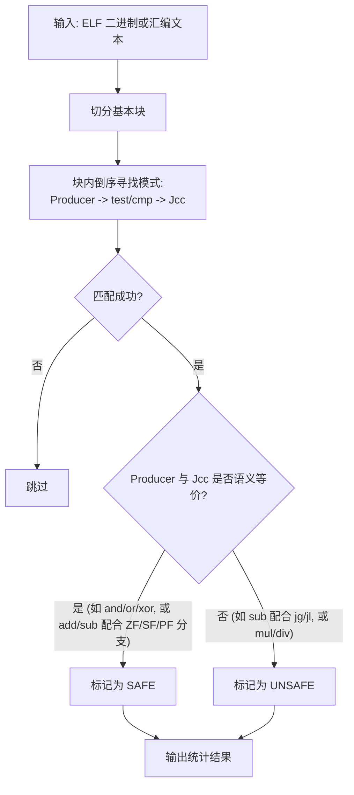
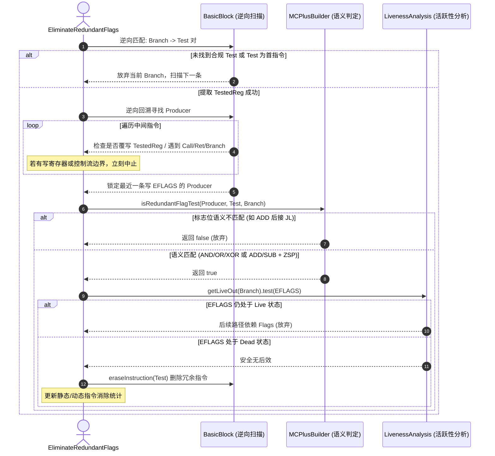

# LLVM 版本等信息
- 基线版本 commit: `8b4942db9a90f600e9083e3d41888ae334938a93` (24.0.0git)
- 本次实验新增的 FLAG : `--eliminate-redundant-flags`
- 操作系统 : ` Ubuntu 24.04.4 LTS` 
- CPU : `Intel(R) Xeon(R) Gold 6326 CPU @ 2.90GHz`
- 内存 : 512G

# 复现步骤
- 必须是x86环境
- 由于默认的运行是绑定在CPU5上的(`taskset -c 4`)，请确保物理核心数大于等于5不然会报错
- 可以使用`perf`
如果是在宿主机运行:
```bash
USE_PERF=1 ./run_experiment.sh
```
默认是带perf的，在docker内使用perf可能比较麻烦，先构建镜像
```bash
docker build -t 51295903121-zhoulicheng-bolt-redundant-flags:0.1.0 .
```
验证一下是不是带perf
```bash
docker run --rm 51295903121-zhoulicheng-bolt-redundant-flags:0.1.0 bash -c "which perf && perf --version"
```
输出:
```txt
/usr/local/bin/perf
perf version 6.8.12
```
启动:
```bash
docker run --rm --tmpfs /tmp:exec \
  --cap-add=PERFMON \
  --security-opt seccomp=unconfined \
  -e USE_PERF=1 \
 51295903121-zhoulicheng-bolt-redundant-flags:0.1.0
```
观察结果
```txt
--- [1] 原始二进制 ---

 Performance counter stats for '/tmp/bolt_deepsjeng_work/bin/deepsjeng.reloc /workspace/load/531.deepsjeng_r/tests/input.txt' (3 runs):

       86568329484      instructions:u                   #    1.96  insn per cycle              ( +-  0.00% )
       44171057285      cycles:u                                                                ( +-  0.13% )
        8004542536      branches:u                                                              ( +-  0.00% )
         204527760      branch-misses:u                  #    2.56% of all branches             ( +-  0.02% )

           13.7137 +- 0.0101 seconds time elapsed  ( +-  0.07% )

--- [2] 基线 BOLT ---

 Performance counter stats for '/tmp/bolt_deepsjeng_work/bin/deepsjeng.bolt.original.full /workspace/load/531.deepsjeng_r/tests/input.txt' (3 runs):

       86402852592      instructions:u                   #    1.98  insn per cycle              ( +-  0.00% )
       43662365499      cycles:u                                                                ( +-  0.04% )
        7941620022      branches:u                                                              ( +-  0.00% )
         201168145      branch-misses:u                  #    2.53% of all branches             ( +-  0.02% )

          13.57150 +- 0.00522 seconds time elapsed  ( +-  0.04% )

--- [3] 改进 BOLT (--eliminate-redundant-flags) ---

 Performance counter stats for '/tmp/bolt_deepsjeng_work/bin/deepsjeng.bolt.new.full /workspace/load/531.deepsjeng_r/tests/input.txt' (3 runs):

       85845324781      instructions:u                   #    1.97  insn per cycle              ( +-  0.00% )
       43526343989      cycles:u                                                                ( +-  0.03% )
        7941620195      branches:u                                                              ( +-  0.00% )
         200350664      branch-misses:u                  #    2.52% of all branches             ( +-  0.01% )

          13.53237 +- 0.00557 seconds time elapsed  ( +-  0.04% )
```

我们还有个不带perf用bolt-instrument来插桩测性能的这个，但是因为这个实验结果本身是减少指令数的，这个负载虽然减少了大量的指令数但是大概就快0.6%左右，最后用time测量看不出什么效果，像下面这样,不建议使用
```txt
[INFO] 当前容器未授予 PMU 硬件计数器权限，改用 /usr/bin/time 进行绑核耗时对比 (CPU 4):
原始二进制 : elapsed=13.40s user=13.11s sys=0.28s
基线 BOLT  : elapsed=13.20s user=12.91s sys=0.28s
改进 BOLT  : elapsed=13.19s user=12.91s sys=0.28s
```
```bash
docker build -f Dockerfile.bolt-instrument -t  51295903121-zhoulicheng-bolt-redundant-flags-instrument:0.1.0 .
docker run --rm --tmpfs /tmp:exec 51295903121-zhoulicheng-bolt-redundant-flags-instrument:0.1.0
```


# 问题描述
在x86汇编中，许多算数和逻辑指令，比如(AND,OR,XOR,ADD,SUB等)在计算结果的同时，已经顺带修改了标志寄存器，比如ZF,SF等，但是在编译器(尤其是O0尚未开启优化的时候)，生成的代码里面，常常会在执行完计算指令后，紧接着又跟了一条专门用于检查结果的指令，比如：
```asm
and   -0x18(%rbp), %rax   # 此时 ZF 已经被设置好
test  %rax, %rax          # 冗余：多做了一次完全相同的标志位检测
jne   ...                 # 条件跳转实际只需看 ZF
```
这里的`test`是多余的，会占用CPU前端解码的带宽，现有的LLVM自身的`PeepholeOptimizer`虽然在后端CodeGen阶段提供了针对冗余标志位的消除逻辑，但是在实验中，发现仍有大量冗余指令“逃逸”到了最终生成的机器码中，且该优化依赖-O1/-O2/-O3开启完整的CodeGen优化流水线，在-O0的情况下被完全跳过。故本次实验加入了`--eliminate-redundant-flags`，他是作用于后链接期的，接受最终的ELF机器码，与编译器无关，且不论编译参数是-O0还是其他的高优化级别，只要反汇编后存在该特定模式，均能尝试消除。
## 负载
这里选用SPEC CPU2017 `531.deepsjeng_r` 作为负载，该负载源自于Deep Sjeng WC2008，是对早期象棋程序Sjeng的重写与升级，包含大量的整数比较(CMP/TEST),条件分支(JCC),位操作等，容易产生冗余的CMP/TEST指令，非常适合本次实验。
## 快速检测脚本
编写了一个快速检测冗余标志位的脚本[find_redundant_flags.py](./scripts.local/find_redundant_flags.py)
简单来说，该脚本定义Producer(生产者)——即修改了目标通用寄存器内容的计算指令，如`add`,`sub`,`or`等，Consumer(消费者),即条件跳转指令(Jcc)如(je,jne,js,jns)这些指令根据EFlags标志位来决定跳转的方向，中间的TEST/CMP如果前面的Producer在计算结果的同时已经顺带设置了标志位，且后续的Consumer只读取这几个标志位，那么中间这条TEST/CMP就是多余的，可以直接消除。

## 原始负载测试
- 使用 [Makefile](./load/531.deepsjeng_r/Makefile) 编译二进制
- 检查生成的二进制
```txt
(base) [20:41:41] zlc :: solegpu2  ➜  hb_llvm_commit/load/531.deepsjeng_r » readelf -h ./bin/deepsjeng.reloc | grep 'Type:'
  Type:                              EXEC (Executable file)
  (base) [20:44:40] zlc :: solegpu2  ➜  hb_llvm_commit/load/531.deepsjeng_r » readelf -S ./bin/deepsjeng.reloc | grep '\.rela\.text'      1 ↵
  [17] .rela.text        RELA             0000000000000000  0004db48
```
- 正确性验证
输入测试数据，用diff看和正确输出有无差异，无差异，输出正常
```bash
cd load/531.deepsjeng_r/tests
taskset -c 4 /usr/bin/time -f 'elapsed=%e user=%U maxrss=%MKB' ../bin/deepsjeng.reloc input.txt > output.out
diff answer.out output.out  # 无输出，表示正确
```
- 使用脚本观察可能被删除的候选CMP/TEST
```py
python3 scripts.local/find_redundant_flags.py ./load/531.deepsjeng_r/bin/deepsjeng.reloc > scripts.local/origin_bin.out
```
观察输出 [origin_bin.out](./scripts.local/origin_bin.out) 找到了非常多的冗余CMP指令
```txt
...
SAFE   0x41b24e: and $0x1,%eax
       0x41b251: test %eax,%eax
       0x41b253: jne 41b28b <_Z18reset_piece_squareP7state_t+0x2f1>
       and 与 test 在 Jcc 使用的全部标志位上等价

summary: 220 safe, 0 unsafe
safe producers: {'and': 206, 'sar': 7, 'add': 3, 'xor': 2, 'sub': 1, 'neg': 1}
```
- 使用Perf 计数
```bash
taskset -c 4 perf stat -e instructions,cycles,branches,branch-misses -r 3 -- ./load/531.deepsjeng_r/bin/deepsjeng.reloc ./load/531.deepsjeng_r/tests/input.txt 
```
```txt
Nodes: 9568427 (65.27% qnodes)


 Performance counter stats for './load/531.deepsjeng_r/bin/deepsjeng.reloc ./load/531.deepsjeng_r/tests/input.txt' (3 runs):

    87,801,027,435      instructions                     #    2.01  insn per cycle              ( +-  0.00% )
    43,687,683,152      cycles                                                                  ( +-  0.10% )
     8,192,997,437      branches                                                                ( +-  0.01% )
       199,300,481      branch-misses                    #    2.43% of all branches             ( +-  0.01% )

           13.2970 +- 0.0128 seconds time elapsed  ( +-  0.10% )
```
- 抓取热点函数
```bash
perf record -q -F 999 -g -o ./perfs/deepsjeng_perf_original.data -- ./load/531.deepsjeng_r/bin/deepsjeng.reloc ./load/531.deepsjeng_r/tests/input.txt
perf report -i ./perfs/deepsjeng_perf_original.data --stdio --no-children --percent-limit=1 > ./perfs/deepsjeng_perf_origin_report.txt
```
热点函数生成在[original_report](./perfs/deepsjeng_perf_origin_report.txt),有些多，但是本次实验主要是消除冗余指令，这里就不展开说明了。
- 使用原本Bolt进行优化
Bolt已经构建在 [llvm-bolt](./bolt/llvm-bolt) 
```bash
#采集LBR
perf record -e cycles:u -j any,u -o ./perfs/deepsjeng_lbr.data \
  -- ./load/531.deepsjeng_r/bin/deepsjeng.reloc ./load/531.deepsjeng_r/tests/input.txt

# perf2bolt 转换
./bolt/perf2bolt ./load/531.deepsjeng_r/bin/deepsjeng.reloc -p ./perfs/deepsjeng_lbr.data -o ./perfs/deepsjeng.fdata 
```
使用原版bolt进行优化
```bash
./bolt/llvm-bolt ./load/531.deepsjeng_r/bin/deepsjeng.reloc -o ./perfs/deepsjeng.bolt.original.full --data=./perfs/deepsjeng.fdata --reorder-blocks=ext-tsp --reorder-functions=hfsort --dyno-stats -v=1 -lite=0          
```
找到新的text段
```bash
objdump -d -j .text --no-show-raw-insn ./perfs/deepsjeng.bolt.original.full > ./perfs/deepsjeng.bolt.original.text.s
python3 ./scripts.local/find_redundant_flags.py ./perfs/deepsjeng.bolt.original.text.s
```
```txt

SAFE   0x1214ea5: neg %eax
       0x1214eb3: test %eax,%eax
       0x1214eb5: jne 1214c30 <_Z11search_rootP7state_tiii+0x970>
       neg 只在 ZF/SF/PF 上与 test 等价，jne 只使用这些位

summary: 210 safe, 0 unsafe
safe producers: {'xor': 2, 'and': 196, 'add': 3, 'sar': 7, 'sub': 1, 'neg': 1}
```
发现只优化了10条，还有大量的没优化。

使用`perf`进行测试
```bash
taskset -c 4 perf stat -e instructions,cycles,branches,branch-misses -r 3 -- ./perfs/deepsjeng.bolt.original.full ./load/531.deepsjeng_r/tests/input.txt
```

```txt
Nodes: 9568427 (65.27% qnodes)


 Performance counter stats for './perfs/deepsjeng.bolt.original.full ./load/531.deepsjeng_r/tests/input.txt' (3 runs):

    87,625,268,273      instructions                     #    1.96  insn per cycle              ( +-  0.00% )
    44,634,620,444      cycles                        ( +-  0.28% )
     8,106,851,073      branches                        ( +-  0.00% )
       202,344,909      branch-misses                    #    2.50% of all branches             ( +-  0.01% )

           13.5842 +- 0.0363 seconds time elapsed  ( +-  0.27% )
```

# 优化设计
优化设计的思路非常简单对每个基本块，寻找：
```asm
P:  add/sub/inc/dec/neg/and/or/xor/test/cmp
T:  test r, r  或  cmp $0, r
J:  条件跳转
```
在以下条件全部满足时删除 `T`：
1. `P` 和 `T` 在同一个基本块；
2. `P` 的目标寄存器 == `T` 测试的寄存器（精确匹配）；
3. `P` 与 `T` 之间没有指令写 EFLAGS 或写被测试寄存器；
4. `P` 与 `T` 之间没有控制流边界；
5. `T` 紧邻 `J`；
6. `T` 不是基本块的第一条真实指令；
7. `P` 的 flags 语义覆盖 `J` 的条件码；
8. `J` 之后 EFLAGS 不活跃。
## flags的等价性
| Producer | 与 TEST 等价的 Jcc |
|---|---|
| `AND/OR/XOR` | 全部 Jcc |
| `TEST r,r` / `CMP $0,r` | 全部 Jcc |
| `ADD/SUB/INC/DEC/NEG` | 仅 ZF/SF/PF 条件：`je/jne/js/jns/jp/jnp` |
| `SHL/SHR/SAR` | 第一版不支持 |
| `IMUL/DIV/BSF/BSR` 等 | 拒绝 |

# 实现细节
具体的实现patch在 [patch](./patch/bolt-eliminate-redundant-flags.patch)这个位置,
其核心目标是新增一个 `--eliminate-redundant-flags` 选项，在二进制重写阶段识别并消除紧邻条件跳转（Jcc）之前、且已被前序算术/逻辑指令等价设置标志位的冗余`TEST`或`CMP $0`指令。
## 扩展 MCPlusBuilder
在MCPlusBuilder中新增两个接口: `getTestedRegister`去识别TEST/CMP指令，`isRedundantFlagTest` 来判断前驱Producer指令标志位能否安全替代当前Test，具体的表格如下：
| 类别 | 代表指令 (Producer) | EFLAGS 行为特征 | 允许消除的条件跳转 (Jcc) |
| --- | --- | --- | --- |
| **完全等价类** | `AND`, `OR`, `XOR` | 强制清零 `CF=OF=0`；依结果更新 `ZF`, `SF`, `PF`（与 `TEST r,r` 完全一致） | **全部 Jcc 条件**（如 `je`, `jne`, `jl`, `jg`, `jb`, `ja` 等） |
| **部分等价类** | `ADD`, `SUB`, `INC`, `DEC`, `NEG` | 产生真实的借位/溢出，`CF/OF` 与 `TEST` 不一致；依结果更新 `ZF`, `SF`, `PF` | **仅限 ZSP 条件**（只依赖 `ZF/SF/PF`，如 `je/jz`, `jne/jnz`, `js/jns`, `jp/jnp`） |
| **重复测试类** | `TEST r,r`, `CMP $0,r` | 前驱已对同一目标寄存器执行过相同的标志位检测与更新 | **全部 Jcc 条件**（前驱测试条件已直接覆盖后续跳转） |

## 基本块内数据流(Pass)
找到基本块末尾的分支指令(`Branch`)，跳过如 .`cfi_def_cfa_offset`、`.cfi_offset` `等栈展开元数据，或者一些DEBUG标记`,找到相邻的Test指令，并约束Test不能是基本块里面第一条非伪指令，因为如果删除首条语句，可能导致其他路径跳进基本快的入口代码被跳空，破坏栈对齐，从而执行一些非法指令。

## 活跃性检查
由于TEST具有将`CF=OF=0`确定性写入的副作用，若后续基本块路径在未重新生成标志位前读取了`CF`或`OF`，直接消除会导致未定义行为。因此，通过 `LivenessAnalysis::getLiveOut(Branch)` 最后再做一次验证：在条件分支之后，EFLAGS 寄存器必须处于 Dead 状态。

## 流程图

# 实验验证
由于在 **原始负载测试** 这一节已经讲述对应的负载编译，构建，采集perf等内容，故本章直接使用构建好的新bolt验证即可: 
```bash
./bolt/llvm-bolt ./load/531.deepsjeng_r/bin/deepsjeng.reloc -o ./perfs/deepsjeng.bolt.new.full --data=./perfs/deepsjeng.fdata --reorder-blocks=ext-tsp --reorder-functions=hfsort --dyno-stats -v=1 -lite=0 --eliminate-redundant-flags
```
## 使用先前的测试脚本验证
```bash
objdump -d -j .text --no-show-raw-insn ./perfs/deepsjeng.bolt.new.full > ./perfs/deepsjeng.bolt.new.text.s
python3 ./scripts.local/find_redundant_flags.py ./perfs/deepsjeng.bolt.new.text.s
```
可以看到输出，一开始未优化时，是**220个**，使用bolt基线优化时是**210个**，现在是**20个**
```txt
SAFE   0x1214c7d: neg %eax
       0x1214c8b: test %eax,%eax
       0x1214c8d: jne 1214a08 <_Z11search_rootP7state_tiii+0x96c>
       neg 只在 ZF/SF/PF 上与 test 等价，jne 只使用这些位

summary: 20 safe, 0 unsafe
safe producers: {'xor': 2, 'and': 8, 'add': 1, 'sar': 7, 'sub': 1, 'neg': 1}
```

## 正确性验证
```bash
taskset -c 4 /usr/bin/time -f 'elapsed=%e user=%U maxrss=%MKB' ./perfs/deepsjeng.bolt.new.full ./load/531.deepsjeng_r/tests/input.txt > ./perfs/deepsjeng.bolt.new.output
diff load/531.deepsjeng_r/tests/output.out ./perfs/deepsjeng.bolt.new.output
```
无输出，说明新的pass并不会修改程序原有的行为导致错误。

## Perf 验证
```bash
taskset -c 4 perf stat -e instructions,cycles,branches,branch-misses -r 3 -- ./perfs/deepsjeng.bolt.new.full ./load/531.deepsjeng_r/tests/input.txt
```
观察输出:
```txt
 Performance counter stats for './perfs/deepsjeng.bolt.new.full ./load/531.deepsjeng_r/tests/input.txt' (3 runs):

    87,066,854,280      instructions                     #    1.99  insn per cycle              ( +-  0.00% )
    43,666,277,734      cycles                        ( +-  0.06% )
     8,106,846,780      branches                        ( +-  0.00% )
       201,640,195      branch-misses                    #    2.49% of all branches             ( +-  0.03% )

          13.29021 +- 0.00766 seconds time elapsed  ( +-  0.06% )
```

对比前两次输出，可以总结出如下表格

| 指标项 | 原始二进制  | 基线 BOLT  | 改进 BOLT  | 改进版 vs 基线 BOLT | 改进版 vs 原始二进制 |
| --- | --- | --- | --- | --- | --- |
| **执行指令数 (`instructions`)** | 87,801,027,435 | 87,625,268,273 | **87,066,854,280** | **-558,413,993 (-0.64%)** | **-734,173,155 (-0.84%)** |
| **CPU 周期数 (`cycles`)** | 43,687,683,152 | 44,634,620,444 | **43,666,277,734** | **-968,342,710 (-2.17%)** | **-21,405,418 (-0.05%)** |
| **每周期指令数 (`IPC`)** | 2.01 | 1.96 | **1.99** | **+0.03 (+1.53%)** | -0.02 (-1.00%) |
| **总分支数 (`branches`)** | 8,192,997,437 | 8,106,851,073 | **8,106,846,780** | 几乎不变 (-0.00%) | -86,150,657 (-1.05%) |
| **分支预测失误 (`branch-misses`)** | 199,300,481 (2.43%) | 202,344,909 (2.50%) | **201,640,195 (2.49%)** | **-704,714 (-0.35%)** | +2,339,714 (+1.17%) |
| **耗时 (`time elapsed`)** | 13.2970 s | 13.5842 s | **13.2902 s** | **-0.2940 s (-2.16%)** | **-0.0068 s (-0.05%)** |
| **搜索节点 (`Nodes`)** | 9,568,427 (65.27% qnodes) | 9,568,427 (65.27% qnodes) | 9,568,427 (65.27% qnodes) | **完全一致** | **完全一致** |


## 实验结果总结

1. **消除了大量的冗余指令**：开启 `--eliminate-redundant-flags` 后，程序总动态执行指令数在基线 BOLT 布局优化的基础上进一步净减少了 **约 5.58 亿条（-0.64%）**，相比未优化的原始二进制累计减少了 **约 7.34 亿条（-0.84%）**，直观验证了新 Pass 在高频热路径中成功剔除了大量冗余的 `TEST`/`CMP` 指令。
2. **IPC 改善**：
* 在 `-O0` 编译生成的未优化二进制上，原始 BOLT 虽然通过基本块与函数重排减少了约 1.05% 的分支，但由于代码体量膨胀、重排引入的局部跳转开销以及分支预测失误率微升（2.43% $\to$ 2.50%），导致基线 BOLT 相比原始程序出现了约 2.16% 的轻微性能退化（耗时从 13.30s 增至 13.58s，IPC 从 2.01 降至 1.96）。
* 引入冗余标志位消除 Pass 后， IPC 从 1.96 拉升至 **1.99**，CPU 周期数下降 **2.17%**，执行时间缩短至 **13.2902s**，相比原始版本得到了优化。
3. **语义等价**：三个版本的搜索树展开规模与静态搜索占比均严格保持在 **`Nodes: 9568427 (65.27% qnodes)`**，证明 `LivenessAnalysis` 活跃性校验与指令等价判定逻辑在保证程序逻辑 100% 正确的前提下，实现了稳定、可复现的二进制级性能收益。

# 局限性
- 目前只验证了x86指令集
- 目前只支持同一个基本快内消除Test/CMP
- 不支持移位操作
- 虽然指令大幅减少，但是运行时间收益并不明显

# 这个优化对何种负载有效，对何种负载无效
答：对控制流密集型、包含大量整型算术/位运算与条件跳转的负载具有一定效果，对于浮点/向量计算密集型这样的负载负载，以及已经过`-O3`充分消除冗余后的代码，本优化不会产生明显的指令削减效果。

# 在优化选项开启的情况，对于不满足优化条件的负载不会带来功能/性能回退
答：当开启 `--eliminate-redundant-flags `面对不满足优化条件的负载或代码模式时，这个Pass不会引入任何功能错误或性能回退,原因是在扫描冗余代码后会再做`LivenessAnalysis`校验，任何存在语义歧义或潜在 CF/OF 依赖的指令序列均会被跳过。